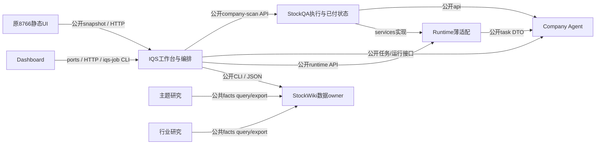

# 活跃产品模块的架构与边界

2026-11-14 更新。活跃产品的模块边界已落到源码包、公开协议和隔离联测。固定来源、测试覆盖和审查范围见[组合验证报告](../implementation/parallel-lanes/packages/2026-11-11-modularity-closeout/fixed-combination-2026-11-14.md)。

详细执行入口：[有限收尾路线图](../implementation/parallel-lanes/packages/2026-11-11-modularity-closeout/README.md)、[实际架构证据](../implementation/parallel-lanes/packages/2026-11-11-modularity-closeout/architecture-audit.md)、[公开契约/TDD](../implementation/parallel-lanes/packages/2026-11-11-modularity-closeout/contracts-and-tdd.md)、[整合/交接](../implementation/parallel-lanes/packages/2026-11-11-modularity-closeout/integration-and-handoff.md)。旧日期报告只说明当时验证范围。

## 产品依赖图

QA 对 Runtime 提供协议声明的 effects。Runtime 消费该协议和 Company Agent 的任务 DTO。QA 的具体 provider 与 store 留在 QA 内部。

## Owner与能力域

|owner|能力域/唯一责任|公开边界|当前状态|
|---|---|---|---|
|IQS|题库、路由、答案语义、扫描编排和工作台|域 `api.py`、owner CLI/HTTP、C5 展示快照、C38 名单请求|十个能力域包已入 `master`，原 CLI 路径可用|
|StockQA|供应商、搜索、额度、已付回答、逐题保存/恢复、交付|company-scan API 1.8、owner refresh/lifecycle|固定提交 `f6897ac`，原生子进程完成冷重启与接续|
|Company Agent|任务、策略、runner、事件和 checkpoint|API 2.3、task DTO 1.1、不透明句柄|固定提交 `ba54694`|
|Runtime|会话、工具和原生回执适配|API 1.4、services 1.0、不透明句柄|固定提交 `369a44b`，历史冻结回放有独立入口|
|StockWiki|身份、名单、观察入库、ACK、刷新、查询和交付对账|identity/dashboard/prepare/query CLI、facts 2.7|固定提交 `9a62022`，读取兼容身份 schema 5/6/7|
|原8766工作台|展示、交互和用户草稿|静态资源、公开 snapshot 和 HTTP|固定提交 `3ed6391`，由 IQS 启动与装配|
|统一 Dashboard|自己的 application/domain、客户端和展示|QuickScanPort、JobPort、命令查询、合同 0.1.2-d|固定提交 `b03e14b`，真实浏览器验证命令接续|
|Theme|主题研究结果与只读消费|StockWiki 公共 facts 2.7 query/export|固定提交 `00e4fbd`，真实隔离 CLI 消费通过|
|Industry|行业研究结果与只读消费|StockWiki 公共 facts 2.7 query/export|固定提交 `bb0c3b9`，真实隔离 CLI 消费通过|

company-wiki继续拥有原件/来源EvidenceSpan，快扫只用公开SourceRef，不把文档下载或其内部重构纳入本专项。历史viewer、实验Lab不作为新增产品owner。

## IQS 包布局

`scripts/iqs_scan` 内的 `foundation`、`questions`、`answers`、`query`、`providers`、`execution` 和 `workbench` 承载产品实现。`experiments`、`acceptance` 和 `tools` 从外侧组合能力。共享操作经对应域 `api.py` 的显式导出进入，工作台主要经 CLI/HTTP 对外。基础契约保持单向依赖，题库和答案共用题义标识，执行编排在组合点连接各 owner。

有状态的执行网关、工作台服务和持久化适配器封装状态及生命周期。解析、验证、路由和投影保留纯函数。旧 `scripts/*.py` 文件保留原命令和旧 Python 导入兼容，规范内的调用使用公开 API。StockQA 现行答案语义接口仍能从已发布路径 `scripts/answer_validation.py` 读取。

## 设计层的封装要求

1. 模块按能力/状态owner划，不按每个`.py`文件划。域内helper允许协作；不要给每个帮助函数增加协议版本。
2. public facade不只是改名字：返回窄DTO/opaque句柄，输入只取本行为所需值/port；不传万能control，不向外返回module/SDK/store/runner。
3. composition选择实现与资源位置；domain/application只依赖ports与本域规则。公开export可读，owner内部目录/数据库不可跨域直接读。
4. 必需语义校验保留；历史测试数/pin、schema排版、源码布局与新发送资格不能阻挡独立有效的只读/已付恢复。
5. 普通私有字段访问在句柄上报错；跨实现导入由架构测试/CI报错。Python下划线/`__all__`不是安全沙箱，不新建全局import权限系统。

## TDD的完成证明

- 最小公开fake运行；返回嵌套数据修改不改变owner。
- 域方向/私有越界mutation被捕获；合法域内helper与兼容协议仍通过。
- 已付保存/封包/ACK恢复不重发，never_sent按原授权首次发，unknown先查。fresh复用无需新key；真正expired新发仍需凭证/预算。
- 当前提交源码在新进程运行，不加载冻结实验conftest；通过原SDK脚本化wire与隔离库执行到ACK/查询/UI。
- 每包一次独审、总控一次组合独审；手写用例计数不作为运行门。

架构验收范围为路线图中的 I1–I7 与列明能力域。正式事实覆盖、研究消费、质量和规模继续沿根 PWF 验收。

## 历史证据如何理解

11/09 F05/E12 的真实单题和已付恢复、11/10 候选接口回归、11/11 Runtime 的局部独审保留在根进度与原报告。当前组合通过原 SDK、隔离 owner 库、脚本化传输和本机浏览器验证。旧实验继续从各自的冻结源码回放，原运行记录无需续签。
