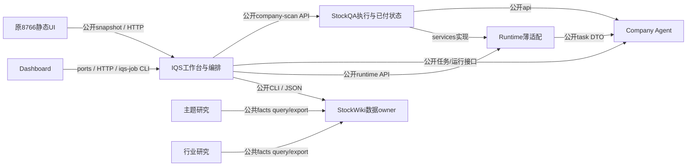

# 活跃产品模块的架构与边界

最后实际调查：2026-11-11。**整体模块化仍未完成。** 本页分开目标设计与实现状态，不把扫描器通过、局部ACCEPT或磁盘候选当作已经交付。

详细执行入口：[有限收尾路线图](../implementation/parallel-lanes/packages/2026-11-11-modularity-closeout/README.md)、[实际架构证据](../implementation/parallel-lanes/packages/2026-11-11-modularity-closeout/architecture-audit.md)、[公开契约/TDD](../implementation/parallel-lanes/packages/2026-11-11-modularity-closeout/contracts-and-tdd.md)、[整合/交接](../implementation/parallel-lanes/packages/2026-11-11-modularity-closeout/integration-and-handoff.md)。旧日期报告只说明当时验证范围。

## 目标依赖图

图是目标逻辑依赖，不代表当前每条线均已发布。QA对RT提供effects是协议实现/装配，不允许RT业务import QA具体provider/store，故不能由图中的运行期回调推断静态双向依赖。

## Owner与能力域

|owner|能力域/唯一责任|公开边界|当前状态|
|---|---|---|---|
|IQS|题库/路由、答案语义、扫描编排、工作台应用；不拥有外仓数据库|已有module/task/answer APIs、HTTP与owner CLI；C5公开启动/展示snapshot本轮拟收口|HEAD fbe5b39，含bb20529，另有WIP；API floor当前QA≥1.7/CA2.3/RT1.4|
|StockQA|provider、搜索、额度、paid response、逐题保存/恢复、outbox|company-scan facade、owner refresh/lifecycle ports|HEAD4c24789无facade；canonical磁盘1.5，候选1.8，需归拢提交|
|Company Agent|task/策略/runner/事件/checkpoint语义|api2.3、task DTO1.1、opaque句柄|793bfbc已提交；保留封装，补公共行为/组合验证|
|Runtime|会话/工具/receipt薄适配，不新增预算库|api1.4、services1.0、四操作句柄|5839ef4无api，候选未提交；冻结测试与当前组合需分开|
|StockWiki|身份名单、观察入库/ACK、刷新准备、查询投影、交付对账|已有identity/dashboard/prepare/query CLI；facts2.7|12c441e已提交边界调整；宽control、域间环与源码布局检查仍需根修|
|原8766工作台|显示/用户草稿/API client|目标只消费公开snapshot/HTTP，提供静态资源|正确仓iqs-question-bank-ui-lab@47d5354；当前仍反向加载IQS源码与历史目录|
|统一Dashboard|自己的application/domain/ports/adapters与展示|QuickScanPort、JobPort、生成DTO；合同0.1.2-d|b707473；只收口m0/m6/m8注入/方向，不重开九模块工程|
|Theme|主题研究本地输出、只读消费|StockWiki公共2.7 query/export CLI|3352b58有WIP；schema原字节格式误拒已确认|
|Industry|行业研究本地输出、只读消费|同一公共2.7 wire|7d49ca3；验证协议重复解释与局部失败行为|

company-wiki继续拥有原件/来源EvidenceSpan，快扫只用公开SourceRef，不把文档下载或其内部重构纳入本专项。历史viewer、实验Lab不作为新增产品owner。

## 设计层的封装要求

1. 模块按能力/状态owner划，不按每个`.py`文件划。域内helper允许协作；不要给每个帮助函数增加协议版本。
2. public facade不只是改名字：返回窄DTO/opaque句柄，输入只取本行为所需值/port；不传万能control，不向外返回module/SDK/store/runner。
3. composition选择实现与资源位置；domain/application只依赖ports与本域规则。公开export可读，owner内部目录/数据库不可跨域直接读。
4. 必需语义校验保留；历史测试数/pin、schema排版、源码布局与新发送资格不能阻挡独立有效的只读/已付恢复。
5. 普通私有字段访问在句柄上报错；跨实现导入由架构测试/CI报错。Python下划线/`__all__`不是安全沙箱，不新建全局import权限系统。

## TDD的完成证明

- 最小公开fake运行；返回嵌套数据修改不改变owner。
- 域方向/私有越界mutation被捕获；合法域内helper与兼容协议仍通过。
- 已付保存/封包/ACK恢复不重发，never_sent按原授权首次发，unknown先查。fresh复用无需新key；真正expired新发仍需凭证/预算。
- 当前提交源码在新进程运行，不加载冻结实验conftest；通过原SDK脚本化wire与隔离库执行到ACK/查询/UI。
- 每包一次独审、总控一次组合独审；手写用例计数不作为运行门。

有限退出范围为路线图中的I1–I7与列明能力域。通过后关闭架构专项，继续原F05/W11/G4、质量和规模目标；这些业务目标不反过来成为无期限的模块化验收条件。

## 历史证据如何理解

11/09 F05/E12真实单题/已付恢复、11/10候选接口回归、11/11 Runtime36项及独审ACCEPT都保留在根progress和原报告。它们有真实价值，但不能证明新的9仓组合已发布。Runtime“current_sources”的7项仍使用冻结来源；旧218/219和pin问题从当前默认功能验收剥离，不继续刷新历史回执求绿。

本轮仅完成架构调查/规划，没有新运行产品测试或收费API；各包实际进度以根task_plan和本目录路线图为准。
