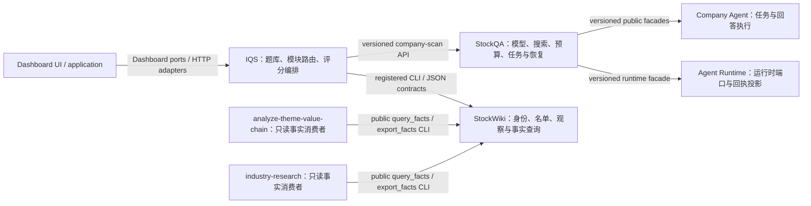

# 快扫产品模块归属与公开边界

最后核对：2026-11-10。本文登记参与快扫正常运行的产品模块、状态归属、公开接口和允许依赖方向。它描述的是运行时边界，不把测试工具、历史证据目录或普通 helper 文件算作独立产品模块。

## 运行时关系

跨仓调用经过 facade、CLI/HTTP port 或版本化 JSON contract。消费者不通过导入对方私有 Python 路径、读取对方文件目录或打开对方数据库来取得产品数据。模块内部仍可调用本 owner 的私有实现。

接口分两层管理：跨仓产品合同和被明确登记为稳定协作者的仓内 API 使用版本与导出白名单；同一 owner 内的辅助实现模块不逐文件建立版本协议，也不因此变成跨仓接口。仓内协作可以使用非私有符号，但禁止跨模块访问下划线私有符号、动态导入绕开登记边界或越权读取 owner 数据。该划分避免把每个 helper 都升级成独立产品模块，同时让真正需要兼容的接口具有可检查的合同。

## Owner 与合同

| Owner / 产品边界 | 唯一负责的数据与行为 | 对外公开入口及版本 | 允许依赖方向与主要消费者 |
|---|---|---|---|
| **invest-quick-scan (IQS)** | 公司扫描编排；题库模块、路由决策、标准答案投影和扫描 UI 合同 | 题库模块 schema `$id=urn:iqs:quick-scan:question-module:1`；每个模块有独立 `module_id`、语义版本及不可变 release/lock；当前 router `2.5.0`、routing policy schema `1.3.0`、route decision schema `2.0.0`。跨仓任务 port 为 `stockqa.company_scan_task_port/1.0.0`；owner API 兼容最小版本见 `scripts/shared_company_ports.py` | IQS 编排到 StockQA company-scan facade，并经公开 owner 命令/JSON contract 到 StockWiki；不拥有 StockQA 工作库或 StockWiki 身份/观察库 |
| **StockQA** | LLM 与搜索 provider、请求/额度/预算、扫描执行、work ledger、checkpoint 与恢复 | `src.utils.quick_scan_company_api.PUBLIC_API_PROTOCOL = stockqa.company-scan-public-api/1.5.0`。StockQA 内部 WorkStore 跨模块导出协议为 `stockqa.quick-scan-work-store-module/1.5.0`；该模块协议只供 StockQA owner 内部模块使用，外部消费者应使用 company-scan facade。 | IQS 只调用 company-scan facade；StockQA 通过 Company Agent 和 Agent Runtime 的公开 facade 组合执行；工作库由 StockQA 独占 |
| **Company Agent** | agent task contract、回答验证、执行/恢复及导出 | `iqs_company_agent_lab.api.PUBLIC_API_PROTOCOL = iqs.company-agent-public-api/2.3.0`；显式 export map 与 `__all__` 限定公开名字 | 由 StockQA 集成层调用；外部消费者经 `api` facade，不导入 runner、answers 等内部模块 |
| **Agent Runtime** | runtime service port、原生回答与工具调用回执投影 | `iqs_agent_runtime_lab.api.PUBLIC_API_PROTOCOL = iqs.agent-runtime-public-api/1.4.0`；`RUNTIME_SERVICES_PROTOCOL = iqs.agent-runtime-services/1.0.0`；facade 返回的 opaque port 只开放声明的操作 | 由 StockQA/IQS 执行组合按 facade 调用；不越过 `api` 直接访问内部 port/receiptmap |
| **StockWiki** | 公司/证券身份、股票池成员、观察、事实来源与 ACK/查询状态 | 事实查询入口 `python -m stockwiki.quick_scan_query_v2_cli`；能力 envelope `iqs.facts_contract_capabilities/1.0.0`，可协商 capability schema `1.2.0` 并兼容 `1.1.0`；facts wire `2.7.0`，`stockwiki.c06_facts_query/1.0.0`；export `stockwiki.c06_facts_export/1.0.0`；CLI result `stockwiki.c06_facts_cli_result/1.0.0`。原有 query wire 保留其公开版本 | IQS、Dashboard 与只读消费者通过 owner CLI/HTTP contract 使用；数据库和原始 owner 文件由 StockWiki 独占 |
| **investment-dashboard** | UI、HTTP/application 层、Dashboard 自身投影与展示状态 | `backend.dashboard.ports.QuickScanPort` 定义 `capabilities/list_observations/get_result/link`；IQS adapter 使用 owner 声明的协议与 generated DTO；生成合同 `CONTRACT_VERSION = 0.1.2-d`，QuickScan DTO 为 `QuickScanView` | UI → application/service → ports → owner adapters；Dashboard 不从 StockQA/StockWiki 实现层导入模块，也不重算 IQS 分数 |
| **analyze-theme-value-chain** | 主题研究自己的结果与本地 capture/output | `scripts/quick_scan_client.py` 以固定 StockWiki CLI 发起只读查询；接受 capability `1.1.0/1.2.0`，只消费 facts schema `2.7.0`、`stockwiki.c06_facts_query/1.0.0` 与 export `1.0.0` | 只读消费 StockWiki 公共 facts contract；结果留在 Theme 自己的输出根，不回写 owner 数据库 |
| **industry-research** | 行业研究自己的结果与本地 capture/output | `tools/quick_scan_client.py` 使用同一 StockWiki CLI/facts wire；当前常量与 Theme 对齐：facts schema `2.7.0`、query/export protocol `1.0.0`，capability `1.1.0/1.2.0` | 只读消费 StockWiki 公共 facts contract；结果留在 Industry 自己的输出根，不回写 owner 数据库 |

### 仓内协作者与版本化范围

- 版本化范围以稳定协作者/API 白名单为准，不按每个 `.py` 文件机械分配版本。StockQA WorkStore 的 `MODULE_API_PROTOCOL`/`MODULE_API_EXPORTS` 是 StockQA owner 内的稳定协作者合同；外部消费者仍必须走 `quick_scan_company_api` facade。
- StockWiki 的 `tests/test_f05_module_api_boundaries.py` 对 8 个明确登记的稳定模块逐项核验版本和精确导出，并核验消费者只导入这些模块声明的名称；同时扫描全部 `quick_scan_*.py`，拒绝下划线私有导入/成员调用及常见动态导入绕行。其他未登记的 `quick_scan_*` 实现文件属于 StockWiki owner 内部协作，不是跨仓协议，不要求逐文件版本号。当前独立审查没有发现这些边界上的 P1/P2。
- IQS/StockQA/Company Agent/Runtime/Dashboard/Theme/Industry 的表内版本字段表示仓间或已登记模块合同；各 owner 的局部 helper 仍由其仓内测试和实现共同演进。若某 helper 开始被跨 owner 消费，必须先迁入已有 facade 或登记版本化入口并加合同正反例。

### IQS 题库的兼容边界

- 新增/升级题库通过 `kind` 模块（common、industry、stage、overlay、diagnostic 等）独立组合；模块内保留 `module_id` 与语义版本，release/lock 绑定精确工件 hash。改变题目含义应发布新版本并保留旧 release，不静默改写已发布内容。
- 路由策略与题库模块分开升级。router 负责证据门槛与模块选择；模块 schema 负责题目与适用条件；评分/答案 DTO 由已有 schema 版本管理。旧兼容格式只在生产者与消费者明确支持时继续接受。
- 题库、模型执行、事实查询和 Dashboard DTO 各自有 owner。需要组合时通过 versioned contract 传递数据，不将任一方的数据库表或目录当作共享接口。

## 边界回归与审查证据

边界规则用静态 AST 测试阻止产品代码越过已登记依赖：私有跨组件 import/member、常见直接及别名动态 import、直接访问 owner 数据文件/数据库。公开 facade/CLI 的合法调用和明确支持的旧合同由正例测试保留。测试守卫在以下位置：

| 代码 owner | 守卫测试 | 快速/默认测试入口 |
|---|---|---|
| IQS | `tests/test_shared_public_boundaries.py`、`tests/test_dashboard_module_boundaries.py` | IQS fast 测试清单；`scripts/run_tests.py fast --plan` 可见 |
| StockQA | `tests/unit/test_quick_scan_module_boundaries.py` | `scripts/checks.py` daily target |
| StockWiki | `tests/test_f05_module_api_boundaries.py` | `scripts/checks.py` short target |
| Company Agent | `tests/test_public_api.py`、`tests/test_secret_boundary.py` | pytest 默认测试发现 |
| Agent Runtime | `tests/test_module_boundaries.py` | pytest 默认测试发现 |
| Dashboard | `tests/integration/test_module_boundaries.py` | pytest 默认 `tests/integration` |
| Theme | `tests/test_quick_scan_integration.py` 中 QuickScan client boundary 用例 | pytest 默认测试发现 |
| Industry | `tests/test_quick_scan_module_boundaries.py` | pytest 默认测试发现 |

2026-11-10 TDD 先加入失败的别名与嵌套 `getattr(importer, "import_module")(... )` / `getattr(builtins, "__import__")(... )` 反例，再修扫描器。七个边界套件最终通过：IQS 50、StockQA 24、StockWiki 9、Runtime 9、Dashboard 2、Theme 2、Industry 4 项测试及 12 个子测试；Company Agent public API 两项通过。独立 reviewer `final_modularity_audit` 对最终测试、动态导入探针和修订结果给出 **ACCEPT**，无遗留 P1/P2。

这些测试是架构回归保护，不是 Python 运行时沙箱：下划线成员名本身不能阻止任意反射或 `exec`。公开 facade 只导出白名单名称，越界静态调用在测试中失败；不要把该约束表述成抵御恶意代码的安全边界。

## 范围边界

本结论关闭的是上表已登记的活跃生产模块边界和常见绕行回归。它不证明所有未来代码都不可能写出新形式的反射，也不等于真实 owner facts 全覆盖、TH/IN 技能入口实服务 E2E、金融内容准确、G3 的 200 家/G4/G5/G6 或 2000 家规模目标完成。后续新增运行时 owner/consumer 时，先在本表增补唯一 owner、公开入口、版本与允许方向，再在其现有快速测试组加一条正例和相邻越界反例。
