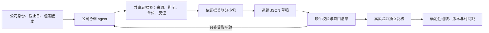

# 公司级 agent：判断、架构与验证路线

2026-10-14。结论状态：旧实验复核与新设计已完成；新 agent 实测尚未执行。本文不变更生产模型顺位，不关闭 B01、Financial、G3 或 F05。

**方案可行，值得验证。我的首选是“公司级协调 agent + 可引用证据表 + 按证据依赖分包 + 定点补救”，而不是让一个不断增长的对话包办全部研究。** 用户方案的价值在于把研究资源集中于一家公司的证据缺口；共享目录、完整 JSON、自我审查本身都不保证准确或缓存命中。

## 旧实验实际上说明什么

|已测情形|可靠观察|解释边界|
|---|---|---|
|B01 三公司各30题，DeepSeek五题包|90/90结构有效；公司wall中位10.664秒，配对逐题速度1.56倍、参考费比0.655|结构有效含unknown/N/A；候选补审14个scored仅4个有限可辩护，不能称高准确率|
|同增强证据，15个数字与3个不足问题，逐题/三题包|18→6 HTTP；两臂15/15数字正确、12/15引用支持；参考费0.039524376→0.020599728 USD，约降47.9%|95.942→80.053秒是请求耗时之和，不是公司wall；窄数字题不是投资评分gold|
|增强取证与复问|DeepSeek增强首答15/15数字、14/15引用支持；两模型各两答数字一致，但仅12项四答都有引用支持|多次一致可能共享同一证据缺口；M3数字正确时理由仍出现十倍单位或年份错误|

原件：[B01](b01-improved-results-2026-10-07.md)、[思考对照](mimo-pro-results-2026-10-07.md)、[准确性实验](accuracy-first-results-2026-10-07.md)。旧思考实验有48次请求实际注入temperature=0.7的偏差，不作为纯思考开关因果证明。旧清理后的URL/hash不能重建全部当时context，新实验重新冻结证据，不冒称精确重跑。

最强信号是：**先取得能支持问题的证据，再考虑模型如何组织回答。** 自审应寻找可验证错误和缺口；反复让模型“更认真一点”不是补证。

## 从第一性原理拆任务

一次回答可以拆成：确定主体/口径 → 找证据 → 判断证据是否足够 → 运算/推理 → 按锚点评分 → 输出。不同问题经常复用前三步，因此不应把每题当成完全独立的研究任务；但这些步骤也不必都放进同一条无限增长的聊天历史。

把问题视为一个依赖图：问题连接其需要的事实，事实连接来源与限定条件。一个搜索可能同时补足五道题；一条错误事实也可能同时污染五道题。调度器优先补“能减少多个关键缺口的证据”，而不是优先找能把分数抬高的材料。

一个公司一个逻辑会话/状态命名空间即可，不必启动一个操作系统容器，更不应2000家同时无限开线程。StockQA继续统一并发、限额、费用、搜索、模型顺位和耐久恢复；StockWiki继续拥有身份及入库；IQS拥有问题/评分合同。新协调器只决定“下一步需要什么”，不另建LLM客户端、费用表或任务队列。

建议分三种记忆：①固定任务合同与身份；②有版本的证据表；③本次问题的相关片段及未解决缺口。事实表至少保留主体、期间、币种/单位、会计口径、来源URL、公开时间、访问时间、短摘录/hash、事实/计划/推断分类及冲突状态。摘要必须回指原短片段，不把模型摘要升级成新来源。

每题可来自基础/行业/生命周期任意模块。模块决定“问什么”；执行分包决定“哪些题可以共享哪些证据”，两者独立。比如杜邦几项可共享同一期财务输入，但证券公司不能直接套制造业资产周转标尺，跨期/跨币种/计划与实绩也不能强行合并。

## 给 agent 自由，但让软件管住边界

- 自由选择搜索顺序、证据关联、先答哪题、何时补充；工具只能访问当前公司获准短证据和公开检索，不能读取评测参考答案或其他公司的私人状态。
- 采用现有 `answer-content.schema.json`，逐题保留题号、score、summary、evidence、counterevidence、missing_fields等完整字段。足证据才给1–10分，缺证据score=null。调用失败在实验slot ledger保留，不擅自给正式schema添加状态或填5分。
- 软件检查原题集合、重复/陌生ID、类型、引用闭合、时间、单位、计算与证据条件。语义支持仍需评审，JSON校验器不能证明财务事实正确。
- 定点修补使用预期旧版本/hash与题号集合；不接受顺手改其他题。最终输出由代码组装已验证记录，避免最后一次长JSON生成截断或改坏正确答案。
- 首答与修订均保留安全的最终答案版本；自审输出“缺口/错误/下一步”，不要求暴露隐藏思考。记录改对、改错、无证据改分三类变化。
- 高分白名单候选、重大风险、内部矛盾和薄来源项优先独立核验，另抽取未被触发的普通项检查漏检。复核者先读题和证据形成判断，再看答案；第二模型投票不代替原始证据。
- 每公司约束请求、搜索、输出token、wall和补救轮数；连续两轮无新增有效证据则退出并保留缺口。中断、限额拒绝、未知发送结果、顺位降级走StockQA既有语义；未知结果不盲重发。

## 缓存：优化有效工作，不能只追缓存率

|层次|复用对象|失效或隔离条件|测量依据|
|---|---|---|---|
|检索缓存|查询与短结果|query、工具配置、截止、TTL/事件|实际外部查询/协议HTTP、命中数|
|证据缓存|已核事实与限定|主体、期间、来源更正、有效期|复用fact数、新增/失效fact数|
|答案检查点|已完成题|题义/锚点、证据版本、目标模型比较策略|实际少发请求，不冒成模型命中|
|供应商prompt/KV|实际请求公共前缀|模型/端点/账户、前缀、缓存策略|供应商usage中的cached/uncached tokens；缺失为未知|

**共享沙盒不是模型共享上下文；读取同一文件也不自动命中KV缓存。** 内容必须实际进入请求，而且前缀必须符合供应商规则。独立的无状态请求同样可以共享前缀，不一定要维持一个长会话。

请求建议排序：稳定system/工具定义 → 本轮稳定题义/锚点 → 公司身份与证据快照 → 当次题目、增量证据和动态状态。时间戳、随机request ID放日志或动态尾部。证据按epoch冻结并追加delta，到明确边界再压缩；压缩后的事实仍可追溯。小题集不强塞全公司历史或所有题库来制造高命中率。

成本模型：未缓存输入×写入/输入价 + 已缓存输入×读取价 + 输出/思考×输出价 + 搜索 + 规划/审查/失败/预热。关注“每个有依据且正确答案的总成本”，分母为0时为null；同时看总账。MiniMax套餐记录请求/token/额度占用与已知现金，不能当免费。

例如仅作算术说明：MiMo Pro中国区按当前报价，100万输入token中90%命中、20万输出，参考费为0.9×0.025+0.1×3+0.2×6=1.5225元；完全未缓存为4.2元。输入命中90%不等于总费减少90%；多轮输出和思考仍可能抵消收益。不是本项目实测账单。[官方价格](https://mimo.mi.com/docs/price)

官方接口核对（2026-10-14）：

- DeepSeek采用公共前缀缓存且为best effort，usage可报命中/未命中；公共前缀发现可能需要多次请求，不能只发两次便断言无缓存。[缓存文档](https://api-docs.deepseek.com/guides/kv_cache/)
- DeepSeek与MiMo的思考工具多轮协议要求保留相应reasoning字段回传。可以仅在运行中的内存保存协议所需字段，最终JSON、日志及长期工件只存最终答案/usage/hash。崩溃后从证据表开新会话须标新segment，不能假装复原未保存的隐藏状态。[DeepSeek](https://api-docs.deepseek.com/guides/thinking_mode/)、[MiMo](https://mimo.mi.com/docs/zh-CN/quick-start/usage-guide/text-generation/deep-thinking)
- MiMo文档不保证强制tool_choice可用，工具参数仍须软件验证。不得为消除思考泄露而静默关闭用户要求的思考。[接口](https://mimo.mi.com/docs/zh-CN/api/chat/openai-api)
- MiniMax当前通用页面已主要展示其他新型号，不能把其所有参数套到MiniMax-M3；本轮Prompt Caching页面两次读取超时，M3具体端点的cache字段与多轮思考保留仍须资格探针确认，不按“Anthropic兼容”推断。[调用说明](https://platform.minimax.io/docs/guides/text-generation)、[缓存文档入口](https://platform.minimax.io/docs/api-reference/text-prompt-caching)
- 供应商Batch API是异步提交许多独立请求，与把30题拼成一个prompt不同。MiMo普通API批处理有折扣，但套餐不适用；可作以后不急的叶子作答任务路线，不能作为本轮已经可用的能力。[官方Batch](https://mimo.mi.com/docs/zh-CN/quick-start/usage-guide/text-generation/batch-api)

## 实验与交付

详细比较、分母、预算、冻结与停止规则见[预注册](company-agent-registration-2026-10-14.md)。独立实现包为[COMPANY-AGENT-01](../parallel-lanes/packages/2026-10-14-agent/COMPANY-AGENT-01.md)，只占新Lab，现有三个包保持不变。先验证三种调度策略，再比较思考开启的DeepSeek、MiMo Pro；Flash/M3与Brave/Tavily/ZAI/原生搜索列入逐步扩展，不同时穷举。

当前结论分开表述：工程上可行；共享证据、适度打包已有小样本节费依据；公司agent能否改善评分质量尚未验证。首选假设是证据驱动协调方案优于全自由长对话，但允许实验结论是“固定小包已经足够”或“质量仍不足，不能推广”。
