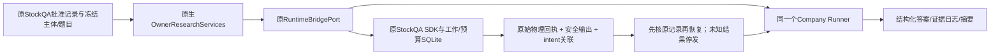

# 共享引擎生产接线：当前实现与验收边界

本文件记录2026-10-18工程推进；生产节点仍在进行。旧施工包离线验收已完成，不能由此推导真实模型准确率、生产owner准入或全股票池已就绪。

## 已交付与在制

- Company核心11路径已按CAS应用并提交 `cd5e3e7ff44aa94cff3f7728c5c38811e9192b85`。独立全套157P/1个原Windows权限skip、独立9反例通过。真实题号投影进入Runner/回放/恢复；检查点深拷贝；证据板绑定原始日志epoch；摘要区分本次新HTTP、历史请求复用和未知用量。Lab没有remote，不新建远端。
- StockQA原生核心15路径已正常提交并推送 `52330ab633d00fa1a282492a6ca9fc809c62e182`（独立精确范围50P与11反例；正常hooks通过）：成功回执与安全可见输出同事务保存，输出摘要进入原不可变回执；外部检索证据必须真正进入wire；错模型pack保留原始用量/回执及unknown屏障。显式多轮登记保留原owner/lease/预算/模型约束，不能用新登记重置上限。
- 崩溃恢复关联同时支持single work及one-shot pack：原intent关联原物理请求，成员必须回原attempt/pack重推，关联摘要还必须与原不可变回执相符。缓存恢复不等于供应商token cache命中；两者分别记录。
- 组合入口使用原Runner，没有第二调度循环或HTTP客户端。已经有合成OS强退和旧合法检查点恢复测试；实际owner软件/完整题组/原SDK组合仍在同一大节点验收，不能拿synthetic port通过替代。

## 不可省略的运行规则

1. 从原批准记录构建实际主体、题目、模型路由与预算。显示名称不是身份；单独的authority_ref、哈希或`owner_public`标签不授予执行权。每次真正发送仍由原owner软件检查当前记录。
2. 先查询同任务同intent的原生记录。已有安全输出时复用原可见响应；没有安全输出而已有原请求时暂停核实；没有原请求才可经原原生准入尝试发送。不能清账本、换owner、新库或改任务ID来重发未知请求。
3. 写原始intent及可验证pending检查点后才发送。收到答案以后、引擎日志落盘以前进程退出，也必须能从原生请求关联找回。新进程不恢复私有思考或SDK会话历史。
4. 回答、source、题目、cutoff、模型、request/response摘要和原始物理attempt须一致。对关联重算自身哈希不能替代源记录核验。
5. 缺失usage、费用或计价来源保持未知；同一原物理请求去重。恢复请求不计成本轮新HTTP，不把缺失观察当零消耗。完成题数不是金融正确率。

## 当前能力限制

原冻结研究协议与实际owner题目契约不能静默互换；新的原生task carrier需由真实批准输入明确构建和验证。当前组合受12题、2026-10-13及已注册策略的范围约束，未宣称任意题数/日期已可运行。单work已登记多轮与原one-shot pack是不同能力；多轮pack、过期lease接管、正式搜索证据检查点及生产CLI完整构造仍须明确验收，不能仅改标签开放。

本轮真实模型/收费搜索请求为0。脚本wire、合成身份和本地批准软件的工程正例，必须标注为隔离测试；下一次真实公司运行仍需原生真实批准/预算记录。旧未知请求与原生产库保持原状。

测试与源码精确绑定见 `../reviews/shared-engine-production-2026-10-18/` 和 `../../../runs/shared-engine-production-2026-10-18/` 的各次CAS、原始测试记录；重叠测试数字不相加。
