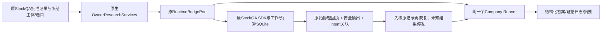

# 共享引擎生产接线：当前实现与验收边界

本文件记录2026-10-18工程推进；本轮工程范围已独立验收，委托入口已独审交付，真实公司及原未知费用续行继续实施。旧施工包离线验收已完成，不能由此推导真实模型准确率、生产owner准入或全股票池已就绪。

## 已交付与在制

- Company核心11路径已按CAS应用并提交 `cd5e3e7ff44aa94cff3f7728c5c38811e9192b85`。独立全套157P/1个原Windows权限skip、独立9反例通过。真实题号投影进入Runner/回放/恢复；检查点深拷贝；证据板绑定原始日志epoch；摘要区分本次新HTTP、历史请求复用和未知用量。Lab没有remote，不新建远端。
- StockQA原生核心15路径已正常提交并推送 `52330ab633d00fa1a282492a6ca9fc809c62e182`（独立精确范围50P与11反例；正常hooks通过）：成功回执与安全可见输出同事务保存，输出摘要进入原不可变回执；外部检索证据必须真正进入wire；错模型pack保留原始用量/回执及unknown屏障。显式多轮登记保留原owner/lease/预算/模型约束，不能用新登记重置上限。
- 崩溃恢复关联同时支持single work及one-shot pack：原intent关联原物理请求，成员必须回原attempt/pack重推，关联摘要还必须与原不可变回执相符。缓存恢复不等于供应商token cache命中；两者分别记录。
- 组合入口使用原Runner，没有第二调度循环或HTTP客户端。已经有合成OS强退和旧合法检查点恢复测试；实际owner软件/完整题组/原SDK脚本组合已经通过整节点验收；仍不能代替真实公司回答准确性。

## 不可省略的运行规则

1. 从原批准记录构建实际主体、题目、模型路由与预算。显示名称不是身份；单独的authority_ref、哈希或`owner_public`标签不授予执行权。每次真正发送仍由原owner软件检查当前记录。
2. 先查询同任务同intent的原生记录。已有安全输出时复用原可见响应；没有安全输出而已有原请求时暂停核实；没有原请求才可经原原生准入尝试发送。不能清账本、换owner、新库或改任务ID来重发未知请求。
3. 写原始intent及可验证pending检查点后才发送。收到答案以后、引擎日志落盘以前进程退出，也必须能从原生请求关联找回。新进程不恢复私有思考或SDK会话历史。
4. 回答、source、题目、cutoff、模型、request/response摘要和原始物理attempt须一致。对关联重算自身哈希不能替代源记录核验。
5. 缺失usage、费用或计价来源保持未知；同一原物理请求去重。恢复请求不计成本轮新HTTP，不把缺失观察当零消耗。完成题数不是金融正确率。

## 当前能力限制

原冻结研究协议与实际owner题目契约不能静默互换；新的原生task carrier需由真实批准输入明确构建和验证。当前组合受12题、2026-10-13及已注册策略的范围约束，未宣称任意题数/日期已可运行。单work已登记多轮与原one-shot pack是不同能力；多轮pack、过期lease接管、正式搜索证据检查点及生产CLI完整构造仍须明确验收，不能仅改标签开放。

本轮真实模型/收费搜索请求为0。脚本wire、合成身份和本地批准软件的工程正例，必须标注为隔离测试；下一次真实公司运行仍需原生真实批准/预算记录。旧未知请求与原生产库保持原状。

测试与源码精确绑定见 `../reviews/shared-engine-production-2026-10-18/` 和 `../../../runs/shared-engine-production-2026-10-18/` 的各次CAS、原始测试记录；重叠测试数字不相加。

## 当前公开操作入口与交付

IQS共享入口已提交推送e8a1ef0；`python -B scripts/shared_company_engine.py capabilities`只输出真实受支持范围，exit0，不读取密钥或派发。`report --input <原导出目录> --output <新的报告目录>`重校原始日志和sidecar后生成报告，不能拿任意JSON当原生owner授权。真正execute/resume为消费已准入OwnerResearchServices的Python API；当前CLI不构造owner。

StockQA原生核心52330ab、owner服务d5cfe50已经正常hooks提交推送；Runtime桥在其原本地分支提交。Task3工厂与完整12题脚本恢复正例已通过同节点独审；这不等于真实公司金融验收或所有生产能力完成。

所有旧收费请求/未知用量保留。真实旧账本20→23兼容验收只迁移只读备份；该结果不意味着原库已升级。新表为空不代表旧请求费用为零，也不能补造旧safe visible output。

## 最终工程验收

同一独立reviewer最终签收原Runner/原owner/原SDK组合，F01–F07全部关闭。Task3工厂只接受原已批准12题、完整题义/模块锁/同一主体、2026-10-13截止日、free_agent全包、零新搜索、MiMo one-shot；不能解释成所有策略/所有公司/日期已开放。Task3恢复只复制描述性owner_binding，每次实际权限仍核原owner。

实际隔离软件E2E435.193秒：cold1次scripted SDK POST，native safe output原子保存后强退86；fresh process恢复12slots、新POST0/replay1/physical1。summary确实从原native回执重建，cash费用为null，owner_authority_verified/financial_qualification_granted均false。0正式搜索checkpoint。软件总墙钟包含原生重复权限检查，不能作为实际模型速度指标。测试环境最小无密钥变量、禁止外联；没有延长600秒原lease。精确source/结果/测试与独审绑定在本节点final.json及native-task3-scoped-acceptance.json。

真实执行下一步是显式delegated owner版本；单纯聊天授权不会被软件误标TTY记录。原S1 unknown/unpriced预约保留，后续原预算续行必须显式实现且保持累计上限与旧任务不重发。

## 单action委托入口已交付

不同agent整包签收15路径，StockQA正常hooks提交推送aaddcd6，StockWiki正常checks本地提交3fad36d（无remote）。原TTY/rc1保持，新rc2明确native_owner_delegated_agent；固定owner namespace读取install，真实OS principal核对、实际preview/request/policy/quote/主体题目模型完整绑定。profile/hash只是来源描述，不是加密agent认证；无需重复索取用户已给的权限，也不能伪称TTY。

原公开流程及固定JSON模板见runs/shared-engine-production-2026-10-18/delegated-owner-candidate/OPERATIONS.md、PROTOCOL.md。最终31契约/103QA/22SW/1公开E2E、独立10反例通过，mypy92源文件通过。公开E2E是实际软件和脚本timeout，原未知费用保留、撤销后0新POST，不作为真实金融正例。

真实下一步是原S1同一账本的native continuation：policy1.4精确接受旧两笔budget-only暴露、完整新cohort/cells、固定permissions-only和原quote确认、每POST原权限预算检查；旧默认暂停保持，新unknown再暂停。不另开干净账本或清NULL费用。真实激活准备以runs/shared-engine-production-2026-10-18/real-activation-preparation.md为准。通用公司任务载体另以显式版本实现，原Task3冻结实验条件不悄悄放大。
