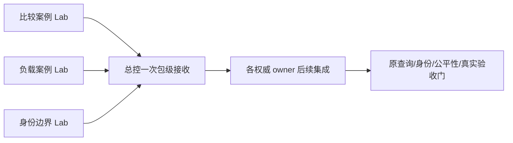

# 2026-10-11：三条互不干扰的独立施工线

> 最新派发状态：用户于2026-10-11确认三个包均已发出，等待各自harness实施和交接。总控不占用三个Lab写根、不重复派发。实时协调记录见[dispatch-status.md](dispatch-status.md)；下方manifest、输入锁和validation保留编制时原始事实，不回写成实施完成。

这是可交给不同harness的完整施工包，不是实施完成或自动派发记录。三个新工作目录在编制时均不存在，可在本卡范围内各自新建独立Git仓；开工先重新检查，不覆盖后来出现的目录或writer。

| 包 | 做完得到什么 | 唯一工作目录 | 现在可开工范围 |
| --- | --- | --- | --- |
| [MATRIX-CASE-01](MATRIX-CASE-01.md) | 公司×时间×模型的固定比较/演进案例，供真实查询与UI接入 | `C:/Users/郑曾波/Projects/iqs-comparison-case-lab` | 案例、封闭schema、离线validate/export工具 |
| [LOAD-CASE-01](LOAD-CASE-01.md) | 全池公平性、并发、限额、续扫与费用的可重放负载和trace分析工具 | `C:/Users/郑曾波/Projects/iqs-load-case-lab` | 合成事件流、离线generate/validate/analyze工具 |
| [IDENT-EDGE-01](IDENT-EDGE-01.md) | 三市场近名/多挂牌/母子/ADR/历史代码的身份边界资料 | `C:/Users/郑曾波/Projects/iqs-identity-case-lab` | 公开网页短事实、候选案例和离线校验/导出工具 |

三个根互不包含，与IQS/StockQA/StockWiki/EVID/FACT完全分开。不依赖另两包未交付的产物，不共享可写数据库、缓存、端口、TEMP、Python安装或Git索引。输入只读，输出仅写自己仓库。C06/W15软件源交付与清理已完成，总控继续B01当前公开链小批次预检；EVID-R2与FACT-R3仍由各原owner接续。这些包不能启动TH/IN或替代它们的G3/F05前置。

## 交给harness

把对应施工卡的完整绝对路径交给一个harness即可；卡内已经链接[共同规则](handoff-rules.md)、[输入锁](inputs.lock.json)、[manifest](manifest.json)和自身交接模板。不需要读聊天。用户既有后续授权适用于本卡限定的新根；同一包只认领一个writer，不自动创建聊天/派发任务。

所有worker先按[共同规则](handoff-rules.md)记录真实开工状态、核输入字节，pin自己的PWF。不在IQS根写计划，不在三生产仓改代码，不把这些Lab升级成执行器、身份库或研究数据库。



## 交回

各自新仓 `docs/handoff/<package-id>/` 交付标准handoff1.0.0和全部附件。分支用 `codex/<package-id小写>`；正常本地提交，未有获准remote不创建、不push。先产品/测试commit，再交接commit。

总控IQS只读结构预检（分别替换包ID和路径）：

```powershell
python -B -X utf8 scripts/parallel_handoff_cli.py --catalog docs/implementation/parallel-lanes/packages/2026-10-11/manifest.json --package-id MATRIX-CASE-01 --input C:/Users/郑曾波/Projects/iqs-comparison-case-lab/docs/handoff/MATRIX-CASE-01/handoff.json
python -B -X utf8 scripts/parallel_handoff_cli.py --catalog docs/implementation/parallel-lanes/packages/2026-10-11/manifest.json --package-id LOAD-CASE-01 --input C:/Users/郑曾波/Projects/iqs-load-case-lab/docs/handoff/LOAD-CASE-01/handoff.json
python -B -X utf8 scripts/parallel_handoff_cli.py --catalog docs/implementation/parallel-lanes/packages/2026-10-11/manifest.json --package-id IDENT-EDGE-01 --input C:/Users/郑曾波/Projects/iqs-identity-case-lab/docs/handoff/IDENT-EDGE-01/handoff.json
```

预检只证明形状/自述范围，不证明输入真值、权限、代码运行或任务完成。每包在同一个稳定候选节点做一次集中测试/审查；修复后只重跑受影响项，不新增逐helper门。源owner接线和全项目门仍由总控负责。

本批编制核验见 `validation.json`；它是文档/输入/模板验证，不是三个包的产品测试。新Lab没有由总控创建或代实现。
