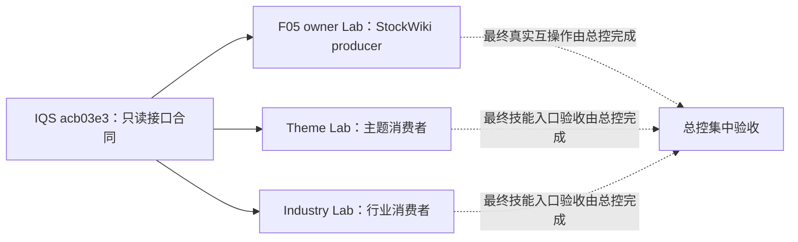

# 2026-11-06 主线消费者并行施工包

**状态：** 可分派，尚未开工。三包按三个独立代码 owner 拆分，工作目录互不重叠：StockWiki owner 端、analyze-theme-value-chain 消费端、industry-research 消费端。不是把同一功能拆成多包。

## 施工包

| 包 | 唯一写入 Lab | 冻结源 | 工作边界 |
|---|---|---|---|
| [F05-OWNER-MAINLINE-02](F05-OWNER-MAINLINE-02.md) | `C:\Users\郑曾波\Projects\iqs-stockwiki-f05-mainline-lab` | StockWiki `master@6d1e40bcdcde5e99488e22c38d57bd8e1b33c27e`；IQS 合同 `master@acb03e3c084f61ca2b49181180195118077d43e3` | 将已审查的 F05 producer 候选适配到当前 StockWiki 代码；只写新 Lab。 |
| [TH-IMPL-02](TH-IMPL-02.md) | `C:\Users\郑曾波\Projects\iqs-th-impl-02-lab` | analyze-theme-value-chain `master@3c9a49c7ce86f3e60eb9a6c8e6c835164cb8a903`；IQS `acb03e3…` | 在主题候选/公司资料流程中可选消费 F05 facts；只写主题技能新 Lab。 |
| [IN-IMPL-02](IN-IMPL-02.md) | `C:\Users\郑曾波\Projects\iqs-in-impl-02-lab` | industry-research `main@98640a9a1f52fc87ba9813676a3cc5ab9bf045c9`；IQS `acb03e3…` | 在行业公司评估/报告中可选消费 F05 facts；只写行业研究新 Lab。 |

精确输入与状态见 [inputs.lock.json](inputs.lock.json)。这些 Lab 路径在编卡时均不存在；Harness 开工时如已出现，先保留并报告现有 owner，不能删除或复用未知目录。

## 三包共享的公开接口

- IQS 主线提交 `acb03e3c084f61ca2b49181180195118077d43e3` 已包含 `query-facts-v2.7.schema.json`（SHA-256 `cd3e03417289a99f5194263603ead6d954fd601b875cd3d5c08a74505ba8cbad`）、`query_facts` / `export_facts` 与能力 wire `2.7.0`。
- F05 owner 候选对外使用工作目录为 `<owner-root>` 的 `python -B -X utf8 -m stockwiki.quick_scan_query_v2_cli --root <owner-root> --iqs-code-root <iqs-root> --request <request.json>`；capability 通过该 CLI 的 `--capabilities --capabilities-version 1.1.0|1.2.0` 入口读取。以 [F05-OWNER-MAINLINE-02](F05-OWNER-MAINLINE-02.md) 冻结的 request/response schema 为准，不导入 StockWiki 私有 Python 模块。
- 两个消费者可以立即基于此契约、合成 wire 样例和可替换的 CLI transport 完成代码及测试。它们**不等**真实 200 家试点、G3、生产 owner golden 或另一消费者交付；真实 owner 互操作由总控在 StockWiki owner 端就绪后集中验收。
- `tasks.json` 中 T01/T02 的 `depends_on: ["F05", "W11"]` 继续有效，表示产品/真实接口集成验收的顺序依赖；它不阻止本批在独立 Lab 里按冻结 facts 2.7 契约先做离线实现和合成测试。此安排符合[接手指南的依赖解释](../../../handoff-for-new-agent.md)：冻结上游接口允许下游开发，不代表集成完成或可越过产品门。F05/W11 真实前置未验收前，消费者包只能交付为离线实现，不能报告真实 owner 集成完成。
- 消费端失败、未知协议、覆盖不足、`unknown`、`partial` 空结果必须显式显示缺口，不能变成零候选；`explore` 线索不能升级为已证实事实。请求只读，不刷新、不入库、不自动搜索或下载。

## 隔离和并行关系

三个源仓与 Lab 各归一个 Harness；任何包都不写 IQS、StockQA、另一个技能源仓、安装镜像、StockWiki 原工作树、事实/观察数据或公司名单。StockWiki 当前原工作树有既存未跟踪路径：`data/companies/688012.SH/research_source_links.sqlite`、`data/dashboard_onboarding/`、`data/dashboard_research_binding/`、`runs/c16b/`。这些路径仅在本页记录为基线状态；**不得打开内容、复制、改动或清理**。StockWiki 包从锁定 commit 的已跟踪 Git 对象创建独立克隆，不会复制这些未跟踪文件。StockWiki owner query 可以按既有协议持久化查询快照/capture；本批不得将真实 owner root 指向 source 或任何生产目录，所有运行测试限定在临时 Lab root 并清理自有临时文件。

这批不外包 G3 真实试点：它会使用原 UI、账户/额度和持久化运行库，需要总控独占安排；本批代码包不运行真实公司扫描、不产生收费调用。旧 `TH-IMPL-01` / `IN-IMPL-01` 的“等 G3、F05、owner golden 才能写代码”是旧基线，新卡只在本批代码范围内取代它们，不改写历史预研或生产验收状态。

## 交接和审查

每个包交回自己的 `docs/handoff/<PACKAGE-ID>/report.md` 与 `handoff.json`；JSON 按 [handoff.schema.json](../../handoff.schema.json) 1.0.0。必须记录冻结 base、最终 commit、变更路径、输入/输出协议版本、测试命令及通过/失败/跳过数、网络/费用、临时目录清理、未完成项。

在交付前，每包由**非作者的独立 agent**对最终 commit 做一次包级代码、测试、接口兼容和范围审查。作者修复所有发现，对修复后的最终 commit 做一次复审；没有真实独立 reviewer、仍有未修 finding、或最终 review 未绑定交付 commit 时，不得报告 `complete`。不要求每个小改动重复审查，也不运行整仓小时级测试，除非目标仓 `AGENTS.md` 明确要求该检查点。

通用约束与交接字段见 [handoff-rules.md](handoff-rules.md)。源仓仅用于读输入，Lab 本地提交，不推源仓远端；最终源仓合并、真实 owner golden、真实产品/技能入口验收归总控。
