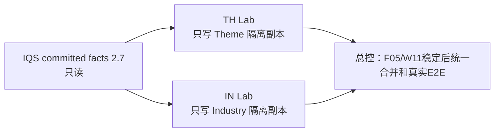

# 2026-11-07 主题与行业源仓接线包

**状态：** 两张卡已备妥，尚未分派/开工。独立只读审查确认两条线可并行，工作目录、源仓和写入路径不重叠。

这批只把已验收的离线消费者移植进各自技能源仓的**隔离副本**，让真实技能流程能选择性调用公开 facts CLI。它不修改两个 canonical 工作树，也不写 IQS、StockWiki 或 StockQA。F05/W11 真实服务和当前 CLI 互操作仍由总控主线验收。

## 可交付施工包

| 包 | 独立 Lab（唯一写入目录） | 冻结源仓基线 | 只读消费者输入 | 施工卡 |
|---|---|---|---|---|
| TH-SOURCE-INTEGRATION-01 | `C:\Users\郑曾波\Projects\iqs-th-source-integration-01-lab` | analyze-theme-value-chain `master@3c9a49c7ce86f3e60eb9a6c8e6c835164cb8a903` | TH-IMPL-02 `5477353649bd86385bc9261bdb2a9f2b30ef63a1` | [TH-SOURCE-INTEGRATION-01.md](TH-SOURCE-INTEGRATION-01.md) |
| IN-SOURCE-INTEGRATION-01 | `C:\Users\郑曾波\Projects\iqs-in-source-integration-01-lab` | industry-research `main@98640a9a1f52fc87ba9813676a3cc5ab9bf045c9` | IN-IMPL-02 `ba54e00f5356831b9bb3ded952c06d43c4c01606` | [IN-SOURCE-INTEGRATION-01.md](IN-SOURCE-INTEGRATION-01.md) |

两张卡只共享 IQS 的已提交只读 facts wire 2.7 输入。包的依据和逐仓保护边界见 [inputs.lock.json](inputs.lock.json)；共用交接要求见 [handoff-rules.md](handoff-rules.md)。

## 当前可做与最终验收的边界

- **可以并行做：** 在各自新建 Lab 中移植已接受的 consumer，实现主题技能/行业研究原流程的可选接线，并用 fake public CLI、合成数据完成定向测试。
- **不能据此宣布：** StockWiki 真实 owner 已连通、真实 owner golden 已验、当前公开 CLI 正反互操作通过、G4 完成或真实公司研究结果已验证。
- **接口版本：** 固定使用 IQS `acb03e3c084f61ca2b49181180195118077d43e3` 的 facts wire 2.7.0 和 schema SHA-256 `cd3e03417289a99f5194263603ead6d954fd601b875cd3d5c08a74505ba8cbad`。总控正在处理的未提交/未发布 2.8 变更不是施工输入；不得读取、复制、依赖或改动该变更。若 2.7 输入对象在本机不可取得，记录 `blocked` 并交回，不自行漂移基线。
- **源仓保护：** 2026-11-06 的来源记录是锁定基线；本次检查发现两个源仓的 `git status` 无法正常返回工作树状态。因此卡片要求从精确冻结 commit 建新 Lab，完全不依赖当前 source 工作树，不覆盖或清理已存在 Lab。
- **后续总控动作：** F05/W11 产品接口稳定后，总控将把接受的 Lab 变更适配/并入各 canonical 源仓，统一跑当前 owner 公共 CLI 和技能入口 E2E。外包交付只提供可审查的源仓候选。

## 并行边界

TH 不得写 Industry 或共用 Lab；IN 不得写 Theme 或共用 Lab；两者都不写 IQS、StockWiki、StockQA、公司池、安装镜像或任何真实 owner 数据。
