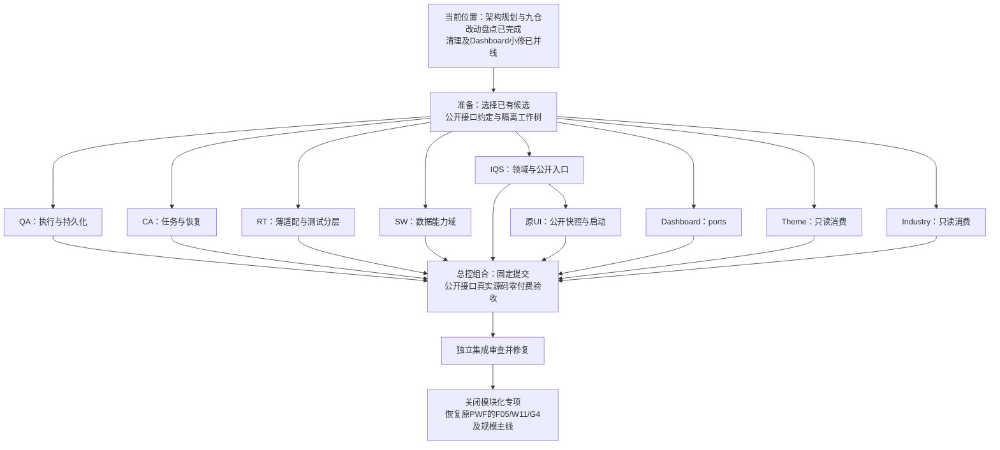

# 模块化与解耦：有限收尾路线图

2026-11-12。状态：八个外仓施工包已逐个验收、提交并快进并入各自主线；MC-IQS 总控代码及跨仓组合仍在实施。本目录取代根 PWF 中“继续追加边界反例、刷新旧回执直到全绿”的旧下一步，不撤销已通过的真实扫描、恢复和入库成果。

### 最新并线状态

|包|主线|当前提交|验证结论|后续归属|
|---|---|---|---|---|
|MC-SW|StockWiki `master`|`f2bc73f`|169 passed / 1 skipped|已并；无生产迁移|
|MC-CA|Company Agent `master`|`ba54694`|38 passed|已并|
|MC-IN|Industry Research `main`|`2b2fc54`|232 passed / 105 subtests；独立 ACCEPT|已并；远端推送待最终组合后核对|
|MC-TH|Theme `master`|`99ac207`|96 passed，真实 MC-SW 2.7 fixture|已并|
|MC-QA|StockQA `master`|`749f6e1`|100 passed / 1 skipped|已并；保留未跟踪用户资料|
|MC-RT|Runtime `codex/agent-run-02`|`f58e0c4`|210 passed / 1 skip；current 25；legacy 7/1 skip；integration 6|已并；字节换行问题经总控修正|
|MC-UI|UI `master`|`3ed6391`|298 OK / 6 skipped；边界 22/1 skip|已并；C5 真服务由总控接线|
|MC-DASH|Dashboard `main`|`3e401cf`|替换/边界组 367 passed|已并；I7、C38 和四个相邻向量待总控验收|
|MC-IQS|IQS `master`|进行中|尚未做最终组合回归|继续本 PWF 主线|

临时包工作树均已回收；各源仓中早已存在的 SQLite、代码索引、生成 JSON、用户记忆、pilot 文件和历史资料保留。外仓局部绿测不等于 I1–I7 完成；MC-IQS 完成后才做一次固定组合审查。

## 本轮新增的入场结果

[九模块未提交/未并线审查](intake-audit/README.md)已完成，并写回下方每张原MC卡。原QA/Runtime有效候选保留；StockWiki C38→IQS C38是明确待并配对；Dashboard两处漏合功能及测试已并入0addea2；随后另一writer提交2049356，当前main以它为基线，本轮不代签该后续实现。清理约1.53GB可再生测试产物，未删除真实/原工作库、原答或有效源码候选；只清理已确认的隔离测试产物。后续先收拢已有成果，不从空HEAD重新实现。

## 为什么拖了这么久

总控此前没有始终把架构完成与局部修复分开：一边扩大私有访问扫描，一边在不同工作树验证候选，最后又被历史交付计数阻挡。具体证据见 [架构调查](architecture-audit.md)。主要是五个问题：

1. **边界单位错了。** 有些检查把每个 Python 文件都当独立模块，把私有名字改公有便算修复，却没有消除宽对象传递、反向依赖和部署目录耦合。
2. **测试对象错位。** Runtime 的“当前源码集成”实际加载冻结实验；局部绿色不能证明当前 owner 版本能组合。边界扫描器已增长到千行，仍不可能成为 Python 安全沙箱。
3. **代码没有收成同一个版本组合。** StockQA 正式工作树 facade 为 1.5，候选为 1.8，两者 HEAD 都不包含它，IQS 却已要求至少 1.7。这个问题不能靠增加局部用例解决。
4. **历史记录成为新代码的门。** 218/219 用例数、旧 freeze/review pin、相同 schema 的原字节格式，都能阻挡与它们无关的正确功能。
5. **模块清单和状态不同步。** 原 8766 UI 实际在 question-bank UI 仓，既有清单却主要写 Dashboard/历史 viewer；部分 PWF 当前表仍引用旧 HEAD。

这轮保留已有 opaque task/runtime 句柄、公开 CLI、预算和恢复实现；按设计边界检查和收口，不重建整套系统。

## 要交付什么，什么情况下结束

**完成含义：下表所有活跃能力域都有唯一 owner、窄公开入口、可替换协作者和可执行边界测试；当前已提交版本组合从用户入口走通保存、恢复、入库及读取。** 不承诺恶意反射无法穿透同进程 Python，不把“所有文件互不调用”作为目标。

- 公开 port 返回不可变值、脱离 owner 的 DTO 或不暴露实现的句柄；常规访问未声明状态会失败。
- 消费者不导入对方实现模块、识别源码目录、直接读写对方数据库。外部显式选择的公开 export 文件可以消费。
- 只有组合根选择实现与路径。业务层只依赖本域值对象和所需 port，不拿万能 control/service/store 对象。
- 正常场景、兼容演进和旧已付恢复能通过；必要的身份、原始数据完整性、幂等和新收费预算约束不被误删。
- 每包一次独立审查；总控一次固定版本组合审查。修复后只重跑受影响项，不每个小步骤独审、全套或刷新凭证。
- 达成上述标准后，**明确关闭本专项**。新的金融准确性、200/2000 家规模和 UI 美化继续归原主线，不追加成“解耦还没完成”的条件。

## 模块与写入分工

表中“源仓”供只读取基线；实现使用该仓独立 worktree。任何两条线都不写同一仓。IQS 保留给总控；若交出 IQS 包，总控暂停 IQS 源码写入。外仓包不能回写 IQS PWF。

|责任线 / 完整施工包|唯一源仓（`C:/Users/郑曾波/Projects/` 下）|本轮重点|依赖与可并行部分|
|---|---|---|---|
|[MC-IQS](MC-IQS.md) 总控|invest-quick-scan|题库/语义/编排/工作台四域；公开启动与展示快照；组合验收|先给 UI 最小公开形状；其余与 owner 并行|
|[MC-QA](MC-QA.md)|StockQAbyLLM|收拢分叉候选；唯一模型/搜索/预算/已付结果 owner|按现有 CA/RT 协议用替身独立实现|
|[MC-CA](MC-CA.md)|iqs-company-agent-lab|保留已提交封装，检验任务/runner/恢复的公开行为|可立即独立验证；不强制产生代码改动|
|[MC-RT](MC-RT.md)|iqs-agent-runtime-lab|收拢薄 runtime；剥离冻结夹具和历史交付门|可用 services fake 开发；最后接 CA/QA 提交|
|[MC-SW](MC-SW.md)|StockWiki|五能力域、publication 窄输入、去源码布局依赖|公开 CLI 保持兼容，可与消费端并行|
|[MC-UI](MC-UI.md)|iqs-question-bank-ui-lab|纯静态资源/API 消费者，去双向源码加载和历史目录知识|可用公开快照/fake HTTP；真启动等 IQS|
|[MC-DASH](MC-DASH.md)|investment-dashboard|仅 m0/m6/m8 的 ports 注入与依赖方向|按既有 D00 ownership 协调；不重开九模块建设|
|[MC-TH](MC-TH.md)|analyze-theme-value-chain|去 schema 字节误拒；独立只读客户端|按现有 2.7 公共 wire 并行|
|[MC-IN](MC-IN.md)|industry-research|统一 wire 解释，局部不可用不拖垮研究|按现有 2.7 公共 wire 并行|

**不是新开 9 个研发支线。** 这是现有专项的 9 个仓库责任范围；其中 CA/IN/Dashboard 的成熟部分可以验证后直接交付。`company-wiki`、历史 `iqs-viewer-lab`、证据/财务/评测 Labs 不是活跃执行 owner，不新增实现包；只保证没有新增对它们内部路径的依赖。

## 依赖路线图

图中依赖是**真实接线顺序**，不是让消费者等 owner 全部完工才能写测试。各包可先用相同公开向量和最小替身开发。

### 阶段和产物

|阶段|具体动作|完成证据|状态|
|---|---|---|---|
|P0 规划|调查各域、明确接口、拆包、独立审计划|本目录；不以此声称源码验收|已完成（见[规划审查](plan-review.md)）|
|P1 固定输入|读取源仓/候选，保留 WIP，建立独立 worktree；按[契约](contracts-and-tdd.md)消除接口歧义|九仓盘点完成；八外仓已快进并入；根 IQS 28 tracked WIP 保留；临时包树已回收|已完成|
|P2 分域收口|先 RED 或确认既有 GREEN，再最小设计修复；各包独审后形成自包含提交|八外仓代码与测试已提交并线；MC-IQS 的 C38/C5/组合入口仍在收尾|进行中|
|P3 组合|总控仅从这些提交导出源码，在短临时根运行当前接口/恢复/查询/UI路径|QA/CA/RT/SW/IQS/UI/Dashboard 固定组合；保存恢复、公开快照与真实读取路径一次打通|未完成|
|P4 发布与返回主线|合并各仓，配置一次选择兼容组合，核对远端/本地发布，再跑轻量部署 smoke|完成集成审查后推送适用的既有 remotes、核对 SHA；最终独审关闭专项|未开始|

进度按阶段产物和责任线交付报告，不按测试数、卡数或“无下划线”百分比。八个 owner 包已形成可检出的主线版本，接下来集中完成 IQS 组合，不再扩新支线。

## 统一设计和 TDD 约定

必须先读[公开契约与 TDD 矩阵](contracts-and-tdd.md)。核心是公开替身、数据深复制、状态唯一 owner、方向检查、兼容向量和真实版本组合。静态检查只覆盖声明的能力域/生产目录；测试夹具、历史资料、临时 worktree 不作为生产依赖。

[整合与交接](integration-and-handoff.md)规定现有 WIP 如何承接、各仓 PWF 如何更新、最终组合测试及提交推送。只保留一份短交接，不增加任务回执框架、release-set 审批或逐断言证明。

## 调度规则

1. 用户把某包交给 harness 后，该包独占自己的工作树；总控只读它的进展。状态变动不自动废弃基线，也不能覆盖他人改动。
2. 需要改变接口时，在本包交接/消息列出“调用者需要什么、提供者缺什么、兼容影响”；总控统一答复并更新契约，消费者不代改提供者。
3. Dashboard 沿用 D00；其他仓用本包命名的 PWF。各仓只记本域计划和结果，总控根 PWF 只记组合状态。
4. 无需重新征求已授予权限。是否有活动 writer 是并发事实，不是另一道权限审批；冲突时隔离工作树并明确合并责任。
5. 本轮不运行收费 API、不改正式数据库/名单、不下载财报。最后架构验收使用原 SDK 的脚本化 wire 和隔离 owner 库；金融质量与真实模型实验沿原主线另计。
