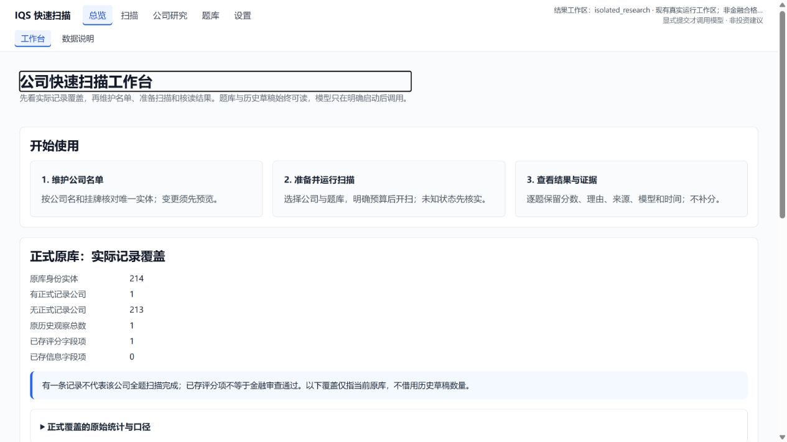

# UI可用性、流程与视觉整改：验收通过

2026-10-25。依据[两份原报告及优先级](../ui-experience-2026-10-25/README.md)完成整改。独立agent `/root/review_ui_whole` 最终签收 `passed`、`open_findings=[]`，绑定21个最终源码/测试SHA；原10项UX与12项VD均有[逐项闭环表](closure-matrix.md)，不把重复根因计作22次独立审查。原报告未改写。

## 用户能直接看到的变化

- 名单按公司名称、市场和代码显示，支持搜索、每页50家及逐行操作；同名不同实体保留原ID，不合并或升级身份。
- 设置默认用连接、模型顺位、额度组、并发和预算字段表单；高级JSON保留。保存中锁编辑，原CAS冲突明确提示重新读取；清空可选路径不残留隐藏值，根空路径不静默恢复默认库。
- 扫描按准备→扫描→交付组织，给出当前下一步；原completed交付指向查看所选范围结果，unknown/partial先核实，不建议盲重发。
- 筛选以题义表达但仍提交原field_id；详情返回保留条件、页码和原快照。单条历史仅显示一次。分数、理由及重大资格缺口主层可读，完整原文、来源与元数据可展开。
- 五个工作区保留旧URL；题库支持键盘、抽屉焦点循环/Escape返回；顶栏约84px。矩阵默认3个基础模块，可切全部48，虚拟化和末行键盘访问保留。长题义控件不再撑破页面，设置字段纵向排列。
- 数据说明和首页将正式原库覆盖、历史草稿、缺失题分开；旧选股器主行只展示本次条件和原三态判定。

## 测试与独立复核

| 范围 | 实际结果与证据 |
|---|---|
| 原owner展示/设置适配 | [40项通过，93.87秒](evidence/backend-green.xml)，原身份按ID联结、缺库不建库、计数不一致拒绝、provider不返回密钥；[TDD摘要](evidence/backend-contract.json) |
| HTTP、原交付/准备接口 | [31项通过，11.54秒](evidence/http-integration.xml)，包括同源/CSRF及原快照；首轮沙箱loopback拒绝14F/17P已[单列留证](evidence/http-environment-denial.json)，合法提权同命令通过，未改断言 |
| 基础交互 | [24项＋18子测试通过，5.50秒](evidence/foundation/tests.xml)；[桌面实测和源码锁](evidence/foundation/verification.json) |
| 产品流程/表单 | [30项通过，8.10秒](evidence/product/tests.xml)，保留原20场景及新增边界；[源码锁](evidence/product/source-lock.json) |
| 内容/旧筛选 | [27项通过，10.11秒](evidence/content/tests.junit.xml)，含原19项算法回归；[来源与范围](evidence/content/implementation.json) |
| 最终独立审查 | [43项前端](evidence/independent/final-frontend-tests.xml)、[8项后端](evidence/independent/backend-tests.xml)、[6组独立边界/返回场景](evidence/independent/negative-results.json)全部通过；[报告](evidence/independent/review.md)、[最终21文件锁与签收](evidence/independent/final.json) |

各批范围有重叠，不相加冒称唯一测试总数；没有跑小时级全套。独审新增IR-01–05全部根修，原失败证据分别保留[首次反例](evidence/independent/negative-results-before-fix.json)、[根路径清空反例](evidence/independent/negative-results-root-clear-before-fix.json)及产品红灯XML。

## 真实浏览器与清理

总控通过CUA操作真实SPA：核对214原实体、正式1家1条/213无记录与12旧草稿分开；同名中信建投两原实体分开；详情返回原宁德筛选和snapshot；历史只有1张原记录卡。临时8770原服务实际保存、CAS拒绝及显式重读，保存期间模型47个/连接21个控件禁用；新可选路径清空后原文件无该键。详见[浏览器记录](evidence/browser-notes.md)、[验收范围](evidence/browser-verification.json)、[隔离保存](evidence/form-save.json)。

1280×720实际：列表高度147.999px；长题义选项修前撑到1362px、修后整页1265px。375/768以固定同源iframe加载真实首页、扫描、设置和矩阵，实际外宽约374.994/767.999CSSpx，截图核对布局；不是物理手机或外层真实resize，未测子文档精确scrollWidth、屏幕阅读器、200%缩放或WCAG合规。最后仅根空路径清空的forms增量由独立ESM/原契约覆盖，其余实际保存动作与最终版同路径，不冒称改后重跑整个浏览器套件。

[自有5个测试根及1个临时HTML已删且核不存在](evidence/cleanup-verification.json)；3个自有隐藏tab已关，8770临时服务已停。现有8766工作台保留，用户原tab未操作。没有下载公司文档，没有收费模型/搜索调用，没有真实配置、库或名单写入；仅隔离配置保存，不读取/导出真实密钥。

[375/768首页](evidence/responsive-dashboard.png) · [扫描](evidence/responsive-operations.png) · [设置](evidence/responsive-settings.png) · [矩阵](evidence/responsive-matrix.png)

## 保留的实际前置

当前48评分模块222题、61信息题题面，基础36题；214原实体为209verified＋5provisional，原状态不变。正式原库1条记录不是全36题完成，更不是金融审查合格；原CATL旧24manifest不改。缺产业关系、第二份历史、模型修订或质量汇总保持原缺口。

本机原prepare仍空，用户模型顺序和新预算未配置；启动扫描仍须原部署/准入/费用授权成立。表单不签发授权、不重置已耗尽r25，不因UI验收授予全池或金融准确性资格。

源码及文档按精确范围提交；UI仓无remote，仅本地commit；IQS推既有origin/master。发布以publication.json及Git实际refs为准。其他writer的10/10README、.codegraph和历史未跟踪材料保留。

归档保留原失败XML的机器输出空白；只对两份原红灯XML设置精确whitespace属性，源码/说明仍正常检查，未跳过提交hook或修改原证据字节。UI提交与受审工作树的CRLF/LF差异单列于publication.json，不冒称全部Git blob原始字节相同。
