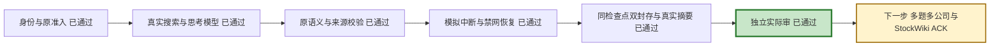

# 共享引擎当前状态（2026-10-25）

本轮工程节点已完成，来自真实CATL单题，不是全公司/全股票池完成。

当前只覆盖原24题manifest中的CATL IQS_05，截止10/18、观察10/25。新一代真实搜索1次/模型1次，模型60.1106秒；恢复128.479秒且0新HTTP，重复封存复用同schema2检查点，delivery=ready。只读摘要与原runtime/report一致，工作库SHA前后相同。完整原请求/费用/context账本行hash不变。

首次暖恢复暴露typed规则遗漏，已修并记录明确不同源码谱系：原72锁/60修前制品保留，新112锁，same_source=false。工程定向63项和摘要器29项通过，最终独审passed/open_findings=[]。累计公开价估算US$0.025023，账单unknown。

尚未授予金融准确性、StockWiki ACK、全量38题或全股票池资格。下一步与交接以根PWF和handoff-for-new-agent.md为准。历史10/18状态页不自动更新为当前。
